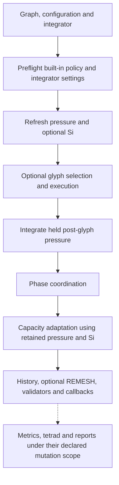

# TNFR Python Engine Architecture

**Python Engine 0.0.3.9**

This reference maps implementation responsibilities and execution boundaries.
Start with the object's [state and execution boundary](#objects-state-and-execution),
choose its [public interface](#public-api) and
[execution path](#relational-execution-and-observation-dependencies), then use
the implementation owners below. Mathematical definitions and proofs belong to
[theory](theory/README.md); detailed admission and mutation guarantees belong
to [API contracts](docs/API_CONTRACTS.md). [AGENTS](AGENTS.md) owns contributor
instructions.

## Objects, state and execution

An organized mathematical object is represented by admitted nodal or collective
state, its constituent and boundary relations, a complete law and an identity
criterion. Its implementation can span a graph, a model declaration and scoped
reports; there is no universal report or Python wrapper that makes every
organization a node of the full operator runtime.

`Network` provides access to graph-owned state and selected execution methods.
For the introductory native object, `RelationalExchangeModel` declares the
joint law, `relational_cycle_capture` assesses recovery and `step_relational`
commits a finite form/phase step. More specialized collective constructions use
their mathematical owners and detached reports. The
[regional workflow guide](docs/guides/REGIONAL_AND_RELATIONAL.md) routes them
without replacing their laws or importing an unrelated execution path.

Keep three boundaries explicit when extending an object study: state sufficient
for its response, transformations admitted on that state, and observations of
the resulting behavior. Collective means or identity labels do not automatically
close a law. Requested operator actions require live targets and grammar
context; their availability does not select their occurrence. The
[collective readiness contract](theory/EMERGENT_ONTOLOGY.md)
owns these mathematical obligations.

## Implementation owners

| Concern | Source of truth |
| --- | --- |
| Contributor and agent instructions; six invariant identifiers | [AGENTS.md](AGENTS.md) |
| Foundation prerequisites before physical mapping | [Research program](theory/RESEARCH_PROGRAM.md#foundational-pillars) owns criteria/activity; [readiness record](theory/research_prerequisites.json) owns evidence associations; [checker](scripts/check_research_prerequisites.py) enforces their integrity and admission in documentation CI. This is a workflow prerequisite, not a physical theorem or runtime law. |
| Mathematical definitions, derivations and scientific scope | [Theory catalog](theory/README.md) |
| Operator channel, scale and postcondition | [`operator_contracts.py`](src/tnfr/operators/operator_contracts.py) |
| Operator-role derivation | [`physics_derivation.py`](src/tnfr/config/physics_derivation.py) |
| Grammar specification | [`grammar_canon.py`](src/tnfr/operators/grammar_canon.py) |
| Grammar validation facade | [`grammar.py`](src/tnfr/operators/grammar.py) |
| Structural constants and operational defaults | [`constants/`](src/tnfr/constants); mathematical status in the parameter foundations |
| Shared selector and Si threshold resolution | [`selector_thresholds.py`](src/tnfr/config/selector_thresholds.py) |
| U3 admission limits and phase-neighbor selection | [`_phase_gate.py`](src/tnfr/operators/_phase_gate.py) |
| Resonance capacity proposal and identity predicates | [`_resonance_identity.py`](src/tnfr/operators/_resonance_identity.py) |
| Nodal pressure computation | [`dnfr.py`](src/tnfr/dynamics/dnfr.py) |
| Nodal integration | [`integrators.py`](src/tnfr/dynamics/integrators.py) |
| Runtime invocation ordinals | [`_runtime_steps.py`](src/tnfr/_runtime_steps.py); separate from physical time, operator counts and retained metric samples |
| Represented-real scalar admission | [`_exact_time.py`](src/tnfr/_exact_time.py), reused by clocks, phases, rates and operator gates |
| Signed scalar EPI admission | [`types.py`](src/tnfr/types.py), validating raw scalars and serialized components before BEPI coercion; shared by standard and optimized execution |
| Finite matrix products, differences and norms for reductions | [`physics/_finite_linear_algebra.py`](src/tnfr/physics/_finite_linear_algebra.py); quotient and morphism checks preserve finite-range failures |
| Active acceleration history and detached evidence | [`nodal_equation.py`](src/tnfr/operators/nodal_equation.py), `observe_structural_acceleration` |
| Optional THOL preconditions and threshold resolution | [`preconditions/self_organization.py`](src/tnfr/operators/preconditions/self_organization.py), [`_thol_config.py`](src/tnfr/operators/_thol_config.py) |
| Public THOL birth proposals | [`self_organization.py`](src/tnfr/operators/self_organization.py) |
| All-node THOL eligibility and explicit finite dispatch | [`self_organization_selection.py`](src/tnfr/operators/self_organization_selection.py) |
| Simultaneous stage execution and graph transactions | [`network_stage.py`](src/tnfr/operators/network_stage.py) |
| Structural fields | [`fields.py`](src/tnfr/physics/fields.py) |
| Regional/relational observations, proof adapters and retained evidence | [Dependency map below](#relational-execution-and-observation-dependencies) |
| Coherence and equilibrium kernel | [`common.py`](src/tnfr/metrics/common.py) |
| Public high-level API | [`sdk/simple.py`](src/tnfr/sdk/simple.py) |
| JSON decoding and atomic file writes | [`utils/io.py`](src/tnfr/utils/io.py); one strict JSON value policy shared by configuration and SDK readers |
| JSON report I/O | [`sdk/utils.py`](src/tnfr/sdk/utils.py); delegates to shared decoding/writing, also used by the CLI and fluent `save()` |
| Research artifact records and byte integrity | [`research/artifact_io.py`](src/tnfr/research/artifact_io.py); exact tagged records, bounded reads/hashes, receipts, ZIP inventory and exclusive creation; scientific admission remains with each consumer |
| Pinned frozen-source preparation | [`research/frozen_source.py`](src/tnfr/research/frozen_source.py); explicit freeze-schema inspection and detached source restoration, without evaluator execution or runtime certification |
| Model-specific research instruments | [Theory-to-execution map](theory/RESEARCH_PROGRAM.md#theory-to-execution); each instrument retains its own state, law and evidence admission |
| Configured validation orchestration | [`validation/validator.py`](src/tnfr/validation/validator.py); fresh checks, shared input/precondition owners and explicit runtime clamp effects |
| Manifest graph transport | [`engines/manifest.py`](src/tnfr/engines/manifest.py); strict v1 records for the supported finite JSON state subset |
| Buffered event storage | [`telemetry/unified_telemetry_system.py`](src/tnfr/telemetry/unified_telemetry_system.py); shared capture/flush path using `utils.io` atomic writes |

These are implementation responsibilities. The [documentation ownership map](docs/README.md)
identifies the single maintained guide for each responsibility.

The `tnfr.physics` public namespace resolves its exports on first access.
One ordered owner map supplies `__all__`, discovery through `dir()` and lazy
dispatch; resolved names are the actual owner objects, not proxies. Importing
one field or observer therefore does not eagerly load unrelated research and
runtime certificates. Direct module imports retain their own dependencies.
The [facade controls](tests/physics/test_physics_facade_imports.py) check cold
imports, public object identity and discovery independently of timing.
The generated [typing facade](src/tnfr/physics/__init__.pyi) re-exports those
same owners for static analyzers. Its
[generator](scripts/generate_physics_stub.py) reads the runtime map without
importing the package; the [testing guide](TESTING.md#code-quality-and-documentation-checks)
owns regeneration and drift checks.

The core dependencies declared in `pyproject.toml` include NumPy, SciPy and
NetworkX. Individual consumers retain availability checks and fallback behavior;
acceleration backends are optional.

## Nodal execution flow

The ordinary runtime composes the following configured operations. The diagram
does not assert that their laws or invocation schedule emerge from one another.

1. Nodes retain signed form, capacity, circular phase, pressure and consumed history.
2. `tnfr.dynamics.dnfr` computes the configured pressure channels. The EPI
   channel realizes random-walk graph diffusion; other channels retain their
   documented circular, capacity, and topology semantics.
3. `tnfr.dynamics.integrators` advances the declared nodal row. Optional Gamma
   is an additive rate source, separate from the unforced product. Rate/history
   evidence depends on the selected execution path.
4. `tnfr.metrics` and `tnfr.physics` compute coherence, equilibrium, the tetrad,
   conservation diagnostics, auxiliary spectra and other read-outs.
5. Grammar-aware sequence and runtime paths enforce word policies and live
   checks. Direct glyphs, public classes and atomic stages have distinct
   secondary effects; a low-level map is not a full sequence certificate.
   Coupling and Resonance retain their path-specific circular U3 checks.

[`runtime.step`](src/tnfr/dynamics/runtime.py) preflights built-in selector,
capacity and phase policies; the default integrator preflights its numerical
parameters. Consumption-time admission still applies, and arbitrary callbacks
or custom integrators do not acquire transaction guarantees from preflight.
With `apply_glyphs=False`, selector construction is skipped.

Built-in selectors share a graph-bound metric snapshot and decision kernel
across scalar, vector and worker paths. Engine batches release their snapshots
on success or failure; manual preparation remains fixed until refreshed or
cleared. Reading a fresh snapshot does not refresh pressure or Si. Default
selection also consumes graph-wide capacity/pressure maxima, so its policy
depends on more than the selected node's local state.

Selection occurs at each outer call's left boundary; integrator subdivision
does not add decisions. The capacity gate reads retained pressure and Si after
integration and phase coordination. Changing those decision times or refreshing
inputs at another boundary changes the supplied hybrid model; see
[native selector timing and inputs](theory/NATIVE_OPERATOR_DYNAMICS.md).

### Foundational integration boundaries

Shared admission precedes materialization, caching and arithmetic:
`_exact_time.py` admits represented real values, `types.py` signed scalar form,
and `alias.py` authoritative attribute access. Each consuming law declares
required coordinates and defaults. The
[parameter ledger](theory/NODAL_PARAMETER_FOUNDATIONS.md)
classifies units and thresholds; a diagnostic policy does not select a law.

Pressure and integration keep distinct owners. Graph/dense pure-EPI paths use
`mathematics/_neighbor_differences.py`; unique-neighbor phase, capacity and
degree channels retain their separate support semantics. The integrator
preserves the registry's live Gamma source in addition to the nodal product.
`dynamics/structural_clip.py` owns numerical clipping policy. Held-step
comparators reuse these arithmetic boundaries but do not authenticate pressure,
prove a continuous solution or convert a hybrid jump into a finite flow.

Rebuildable caches retain their mutation scope. `utils.cache.edge_version_cache`
checks ordered support, node/parallel-key identity and raw `weight`/`length`
channels, including direct edits that leave graph size unchanged. Its scalar
edge check costs O(V+E); other state dependencies belong to the consumer key
or invalidation contract. Graph views compute afresh and concurrent mutation
during a read is unsupported. `utils/unified_cache.py` owns LRU storage and
callbacks; established names in `utils.cache` remain aliases.

Field and metric consumers share the owners in
[structural fields](#structural-fields-and-scope). Invalid authoritative values
cannot be hidden by a cache or another alias, and unavailable observations do
not become zero or a passing verdict. Higher precision does not guarantee
identical rounded decisions at strict thresholds.

### Relational execution and observation dependencies

The repository exposes distinct execution and evidence paths. Reusing state
admission, a coefficient container or an arithmetic kernel does not select the
same complete law.

| Path | Entry point | Execution boundary |
| --- | --- | --- |
| Operator-word studies | `StudySpec` / `run_study`, `Network.evolve` | Registered words execute through shared atomic stages; cycles count complete words. |
| Configured nodal runtime | `runtime.step` | Pressure refresh, optional selection, integration and later phase/capacity updates follow the schedule above. |
| Native relational law | `Network.relational_exchange`, `Network.step_relational` | `dynamics/relational.py` owns the neighbor-resultant Arg field and atomic Euler step. |
| Normalized-sine comparison law | `physics/relational_sine_*` functions | Detached observations, theorem assessments and separately requested validated flow bounds; no native dispatch or default replacement. |
| Supplied observations or linear models | Regional, sample-jet and exact linear-observation functions | The caller supplies the observation map, input law or error premises; a reader does not create them. |

Native `phase_domain` values (`acute`, `positive_resultant`, `regular`) select
admission domains for the **same native law**. Sine readers reuse a regular
`RelationalExchangeModel` as an explicit coefficient/storage reference, but
capture graph/scalar state without evaluating native Arg admission. Their
baseline law identifier is `normalized_sine_reciprocal_exchange`. The declared
`current_squared_reciprocal_mobility` counterfamily shares that capture and
storage but changes both rate rows; its readers retain the separate law ID.
Shared arithmetic does not transfer baseline recurrence or pulse theorems. The
[execution contract](docs/contracts/relational/RELATIONAL_EXECUTION.md#conditional-relational-execution)
and [sine contract](docs/contracts/relational/SINE_COMPARISON_AND_INFERENCE.md#detached-normalized-sine-complete-law-comparison)
own the exact domains and differences.

Coefficient admission has one base owner:
`dynamics/relational.py::_relational_model_coefficients`. The constructor
normalizes weights once; later readers validate the stored coefficients without
renormalizing them. Native staging and `_sine_admission.py` both use that owner.
The sine wrapper adds the regular reference-model requirement, while each
consumer retains its stronger loss, capacity and numerical-budget premises.
`_exact_time.py` distinguishes exact rational admission from finite represented
materialization; a consumer that requires a float must reject nonzero values
lost in that conversion.

#### Shared observation and proof kernels

| Owner | Responsibility and dependency |
| --- | --- |
| [`physics/form_geometry.py`](src/tnfr/physics/form_geometry.py) | Stored-pressure regional contrasts, Gram geometry and conditional affine closure; `Network.regional_form` delegates here. |
| [`physics/source_relative_form.py`](src/tnfr/physics/source_relative_form.py) | Composes the form observer with an independently supplied held rate source; `Network.source_relative_form` is the adapter. |
| [`physics/relational_observations.py`](src/tnfr/physics/relational_observations.py) | Native field, region and hypothetical support-change reports; separately, graph-independent coefficient/rate/sample-jet bounds. Sample adapters share stencils and outward error propagation. |
| [`mathematics/linear_observation.py`](src/tnfr/mathematics/linear_observation.py) | Exact row-space realization and visible/hidden memory for a supplied rational generator; scoped lower bounds distinguish conservative observation from a supplied form-loss model. `physics/epi_memory.py` retains its own diffusion admission. |
| [`mathematics/_exact_linear_algebra.py`](src/tnfr/mathematics/_exact_linear_algebra.py) | Shared rational products, powers, inverses and semidefinite tests; observation, fixed-map stage and arithmetic consumers retain their own model admission. |
| [`mathematics/krylov.py`](src/tnfr/mathematics/krylov.py) | Exact rational rank, Krylov reachability and Hankel moment calculations under their declared input/output premises. |
| [`mathematics/_phase_resultant_chamber.py`](src/tnfr/mathematics/_phase_resultant_chamber.py) | Rational trigonometric/resultant bounds, principal-argument charts and supplied-rate kinematics. Reused geometry does not transfer a law. |
| [`mathematics/_validated_taylor.py`](src/tnfr/mathematics/_validated_taylor.py) | Strict Picard tubes and Taylor remainders; comparison propagation retains its 1–24-coordinate policy, while direct source-box propagation has its separate 1–64-coordinate policy. Each flow adapter retains its layout and other admission budgets. |
| [`physics/_sine_flow.py`](src/tnfr/physics/_sine_flow.py) | Complete normalized-sine form/phase field on admitted geometry, reusing held degree/law factors for interval and jet evaluation. |
| [`mathematics/_validated_metric.py`](src/tnfr/mathematics/_validated_metric.py) | Reuses Picard/Taylor machinery while retaining an SPD-metric radius between steps. The caller proves its whole-tube logarithmic bound; local truncation/rounding errors enter the same norm. Coordinate projections do not replace the retained uncertainty. |
| [`sdk/relational_reports.py`](src/tnfr/sdk/relational_reports.py) | Shared exact JSON projection and supported report delegation, using the atomic SDK writer; not a checkpoint or provenance authenticator. |

Native regional reports consume `dynamics/relational.py`, preserving its nodal
work, mobility and numerical defects. Winding and cut accounting delegate to
`winding_certificates.py` and `support_transport.py`. Hypothetical attachments,
relocations and resets keep event work separate from continuous loss; they do
not change live edges. See the [regional guide](docs/guides/REGIONAL_AND_RELATIONAL.md)
for public adapters and the [composition owner](theory/nodal/RELATIONAL_PATTERN_COMPOSITION.md)
for closure and hidden-information obligations.

#### Native relational proof adapters

Native capture, memory, recovery and transit adapters reuse the admitted field
from `dynamics/relational.py`. They add their own domain, symmetry, positive
capacity/loss and uncertainty premises. Validated trajectories share the Taylor
kernel; static basin readers do not execute an integrator or mutate a graph.

The [theory-to-execution map](theory/RESEARCH_PROGRAM.md#theory-to-execution) owns the
module/proof/test inventory. Public admission and outputs belong to the
[native relational contract](docs/contracts/relational/RELATIONAL_CAPTURE_AND_MEMORY.md).
A small residual cannot substitute for a theorem's full hypothesis set.

#### Normalized-sine proof adapters

The sine layer shares four boundaries:

1. `_sine_admission.py` delegates stored model coefficients to the native
   coefficient owner, then adds the sine reference-model requirements.
2. `relational_sine_comparison.py` owns detached state reconstruction, rates,
   work and resultant kinematics. Mobility and regional/mediated readers reuse
   these primitives while retaining their own complete-law identifiers.
3. `_sine_preparation.py` supplies weighted preparation and uncertainty bounds.
   It also owns exact bounded-length admission of ordered coordinate rows;
   consumers reuse that admission without loading unrelated acquisition
   machinery. Forecasts share validated Taylor/metric kernels and retain
   environmental state, hidden initialization and original error associations.
4. `sdk/relational_reports.py` delegates reports and projects exact JSON values;
   it neither installs a solver nor authenticates an evaluated response.

The private `_organized_*` and `_localized_*` instruments assess collective
state, interaction, identity, event work and observations under declared
complete laws. They are not public SDK dispatch or native evolution methods.
For example, organized winding readers share moment/cycle geometry without
loading source acquisition; separate inclusion checks rebuild the required
source evidence. Isolated-process checks enforce these dependency boundaries.
An observed sector remains partial information: a later interaction still
needs carried coordinates or an endpoint enclosure and the actual contact law.
The [regional instrument guide](docs/guides/REGIONAL_AND_RELATIONAL.md#detached-collective-organization-instruments)
routes these interfaces, and the [theory-to-execution map](theory/RESEARCH_PROGRAM.md#theory-to-execution)
owns their source and test inventory.

The [organized source port](theory/nodal/ORGANIZED_SOURCE_PORT.md) connects
continuous maintenance with operator work and finite reuse. Its detached
passivity and capacity instruments do not execute operator words. Admission,
represented event errors and occurrence remain separate. Prepared matrix-law
observations likewise retain their supplied collective state and measurement
model rather than inheriting a fine-state acquisition certificate.

Public pair state and cancellation belong to `relational_sine_pair.py`;
prepared pulse assessments belong to `relational_sine_replica_pulse.py`.
`relational_sine_scale.py` owns replica geometry, grouping and emission and
re-exports the established pair/pulse APIs. Those imports resolve to the
defining owner objects, including report dispatch and supported pickle names.
Positive-loss formation readers reuse preparation and interval kernels while
retaining their separate law and source domains.

Downstream calculations re-admit the producer's primitive source and rebuild
consumed gradients, rates, work and bounds. Forecast readers also check the
source association at the actual validated time. The
[chained-report contract](docs/contracts/relational/SINE_COMPARISON_AND_INFERENCE.md#sine-chained-report-admission)
owns those interfaces. A static correlated error set, a captured state, a
symbolic invariant family and a validated endpoint box are different inputs.
A chosen moving reference is not a frozen environmental node.

The [scientific connection map](theory/EMERGENT_ONTOLOGY.md)
owns the mathematical implications of reuse. A tangent memory kernel cannot
replace a different nonlinear environment; off-family deviations remain part
of collective interaction.

#### Retained evidence adapters

`research/artifact_io.py` owns shared exact-record encoding, bounded byte reads
and digests, receipts, exact ZIP inventory verification and exclusive record
creation. JSON syntax and finite-value policy still belong to `utils/io.py`.
Model-specific adapters retain their schemas, admission errors and scientific
domains while sharing those mechanics.

Model-specific `tnfr.research` readers reconstruct consumed source, law, clock,
event and observation evidence through shared numerical owners. Generic artifact
integrity or retained Taylor arithmetic cannot replace those checks or prove the
validity of stored derivative enclosures. A hash binds bytes; it neither proves
a mathematical model nor authenticates historical execution.

`reconstruct_box_taylor_arithmetic` in `_validated_taylor.py` re-admits interval
shape, source/tube inclusion and the retained polynomial/remainder arithmetic,
returning increments and intersected endpoints. The source-box solver reuses
this arithmetic; it does not generate derivatives or a Picard certificate on
its own. A detached reader using it must still compare cached outputs and retain
its own complete-law, event and strict-inclusion obligations.

Frozen helper programs and archives remain immutable. Current maintenance code
can audit their bytes without executing them. A later frozen execution requires
its entire declared base revision plus admitted overlays and original environment;
selected archived snapshots are not a replacement for unlisted dependencies.
`research/frozen_source.py` and its `scripts/restore_frozen_source.py` adapter
inspect the explicit supported freeze schema and can prepare a new detached
worktree; they never invoke its scientific entry point or certify its runtime.
The [evidence workflow](docs/guides/RESEARCH_EVIDENCE.md) separates audit,
immutable freeze, source restoration and first-outcome execution.

The [benchmark catalog](benchmarks/README.md) owns instrument selection and
lifecycle. Preparation, prospective prediction, reserved evaluation and
retrospective analysis remain distinct. Available code or a saved verdict does
not create another campaign: the [research program](theory/RESEARCH_PROGRAM.md#research-current-question)
alone schedules research under its current question and admission conditions.

### Operator events and history

For SelfOrganization (THOL), grammar admission, the optional public precondition gate, acceleration
threshold crossing and a viable birth proposal are distinct checks. The public
operator and simultaneous THOL stage share proposal/commit logic; the ordinary
glyph selector's primitive THOL route writes pressure without creating children.
`validate_self_organization` delegates to the shared read-only public
gate and does not write execution telemetry. Gate activation remains a caller/
configuration choice. Birth metadata does not create a transport edge; Coupling (UM) and
its candidate inventory retain their separate owners. These boundaries also
apply to research readiness observations, which must not implement competing
gates or silently select an execution policy.

`observe_self_organization_eligibility` reads all current nodes and retains
independent history, grammar, configured preconditions and complete proposal
results. It shares the stage's detached collision/hierarchy validation.
`execute_eligible_self_organization_stage` is an explicit all-eligible-once
policy: it recomputes eligibility inside one outer transaction, skips empty
sets and reuses the built-in simultaneous public stage. It checks actual
isolated births and preserved original node/edge support; it does not derive
autonomous selection, certify every old attribute or connect the newborns.

History observations expose source, availability, time basis and validated
samples. THOL, SDK nodal reports and propagation diagnostics share this owner.
The numeric `compute_d2epi_dt2` wrapper retains its compatibility zero for
unavailable history; callers needing evidence must inspect the observation.
Mutation's two-sample signed secant and the integrator's cached RHS-rate
difference are distinct quantities. Neither a threshold crossing nor a
historical propagation record proves that an operator caused a bifurcation.

The [event contract](docs/contracts/OPERATOR_EVENTS.md) owns stage atomicity,
history, optional diagnostics and event-schedule transactions. A stage, a
multi-stage word and a scheduled flow/event transaction have distinct rollback
boundaries.

## Package boundaries

### Foundations

- `tnfr.constants` separates canonical structural quantities from operational
  tuning parameters.
- `tnfr.config` owns attribute configuration and contract-derived operator
  classifications.
- `tnfr.errors` provides contextual public exceptions.
- `tnfr.mathematics` owns numerical backends and domain-neutral mathematical
  structures. Its private `_complex_arrays` reader shares original-component
  admission and range-safe normalization across spectral consumers.
  `_integer_admission` owns exact integer/index admission for arithmetic
  modules; primality dispatch and optional SymPy selection remain with
  `number_theory`.
- `tnfr.math.symbolic` owns supplied-law symbolic calculus when SymPy is
  installed. Its public helpers are re-exported by `tnfr.mathematics` and
  `tnfr`; those import paths share the same implementations.

### Structural dynamics

- `tnfr.operators` implements the fixed 13-operator catalog, contracts,
  grammar, preconditions, postconditions, and sequence execution.
- `tnfr.dynamics` computes `Delta NFR`, integrates the nodal equation, and owns
  adaptive evolution services.
- `tnfr.physics` computes fields and mathematically scoped diagnostics.
- `tnfr.metrics` owns shared constitutive and telemetry kernels.

### Orchestration and public APIs

- `tnfr.core` defines service protocols, default implementations, and the
  dependency container.
- `tnfr.services` provides the orchestrator facade over those protocols.
- `tnfr.sdk` provides the supported Simple and fluent user interfaces.
- `tnfr.engines` groups optimization, discovery, integration, and computation
  services that build on the canonical core.

### Domain and research modules

`tnfr.riemann` and arithmetic modules under `tnfr.mathematics` supply explicitly
constructed arithmetic/spectral models.
`tnfr.research` owns reusable evidence and admission infrastructure. These
modules do not redefine the operator catalog, grammar, coherence kernel or
tetrad. Their constructions keep explicit premises; arithmetic or spectral
results do not identify a physical mechanism. Shared graph diffusion, phase
geometry and conditional algebra can be reused under their own contracts.

The [standalone primality utility](applications/primality-test/README.md)
retains basic arithmetic descriptors and a numerical predicate.
`tnfr.factorization` is a deprecated bridge to a separately supplied legacy
package, not a core spectral implementation. It cannot activate the
[archived lab](applications/factorization-lab/README.md) from this checkout.
SDK manifest orchestration is independent of both applications; its dry-run
reports do not execute operator words or establish an optimization result.

## Structural fields and scope

`physics/fields.py` owns the tetrad `(Phi_s, |grad phi|, K_phi, xi_C)` and shared
spatial-profile observations; the tetrad is one selected diagnostic view.
`metrics/common.py` owns coherence reductions. Consumers preserve undefined
curvature and distinguish a fitted coherence length from its spectral fallback.
The [field specification](docs/STRUCTURAL_FIELDS_TETRAD.md) owns formulas,
geometry channels, thresholds and availability; this architecture guide does
not maintain another parameter table.

`sdk.study.diagnose_network` composes the admitted primitive projection and
optional coherence-profile, phase-resultant and supplied winding-cycle evidence
on one detached graph. Shared owners retain their individual domains; optional
observations are computed only when requested. The resolution-aware coherence
reader reuses the live exact-bin profile and an explicit width/radius policy.
It neither replaces the scalar estimator nor adds an evolution law.

Derived fields and diagnostic reductions are observations of the admitted
state. They do not reconstruct arbitrary full nodal states or predict future
evolution. Restricted sufficient descriptions need their own closure proof;
see [state-information scope](theory/MINIMAL_STRUCTURAL_DEGREES.md).

The [physical-emergence atlas](theory/PHYSICAL_REGIME_CORRESPONDENCES.md#electromagnetic-emergence-audit)
separates actual transport and organized-object laws from auxiliary gauge,
wave and harmonic models. Legacy particle-named profile constructors and
interaction-named convenience words do not establish physical species or
forces. Their supplied state, operator execution and diagnostic readouts
retain their own owners; no shared physics label makes their laws equivalent.

## Operator registry and grammar

The lookup in [`operators/registry.py`](src/tnfr/operators/registry.py) lazily
loads the 13 built-in classes and retains distinct-name compatibility
registration. Runtime package scanning is not part of registration. The
canonical inventory remains `operator_contracts`; registering a class does not
add a canonical glyph, grammar role or atomic-stage contract.

Public operator identifiers are the canonical lowercase English tokens.
Reader-facing explanations lead with registered English display names, such
as Coherence (IL); glyphs abbreviate compact words and formulas. The grammar
authority is split deliberately:

1. contract predicates derive operator roles;
2. `grammar_canon.py` materializes U1-U6;
3. `grammar.py` exposes validation;
4. precondition modules enforce state-dependent requirements during execution.

Name and typed words share `GrammarValidator.validate_checks`, defaulting to
`core`; historical adjacency/terminal preferences require explicit `legacy`.
The semantic-validation adapter reports those same checks. Candidate generation
uses this admission before heuristic ranking. Sequential programs separately
retain block/target scope and explicit closure; they use native glyph execution,
not simultaneous network stages or a derived collective event law.

Passing a word validator does not prove infinite-horizon convergence or future
U6 confinement. The exact scope is stated in
[Unified Grammar Rules](theory/UNIFIED_GRAMMAR_RULES.md).
`grammar_debt.read_grammar_state` owns fresh normalized history/bookkeeping
admission. Recording, observations and selector consumers reuse that view;
it is not a cached permission or a certificate of historical execution.

## Public API

`tnfr.sdk.Network` wraps graph-owned nodal state and exposes the native
relational flow and report adapters. `RelationalExchangeModel` supplies that
route's coefficients and domain; it does not configure all other model families.
The [organized-object introduction](examples/01_foundations/01_hello_world.py)
uses these public interfaces together.

`tnfr.sdk.TNFR` owns the Simple construction interface;
`tnfr.sdk.fluent.TNFRNetwork` owns fluent construction and measurement.
`StudySpec` / `run_study` owns the common requested-word workflow used by the
CLI. All routes delegate to their shared runtime and report owners. Public
serialization uses the same strict JSON reader and atomic writer; exports
retain their stated projection scope.

The [CLI/SDK guide](docs/CLI_AND_SDK.md) owns executable usage, and the
[API contracts](docs/API_CONTRACTS.md) own admission and migration. Low-level
operator and dynamics APIs retain their separate event/runtime contracts.

[`relational_report_to_dict`](src/tnfr/sdk/relational_reports.py) uses one
explicit owner registry for supported report types and delegates to their
projections without importing unrelated research modules. Exact fractions,
unavailable values and nested evidence retain their representation. Dispatch
establishes supported Python types; scientific admission remains with the
consuming model. A report export neither authenticates a source nor installs
a law in `Network.G`.

## Numerical backends

NumPy is a core dependency. JAX and Torch are optional numerical backends
selected through the mathematics backend interface and tested through the
backend suite. The repository does not currently contain a dedicated
`TNFRGPUEngine`; backend availability alone is not evidence of CUDA acceleration
or a performance guarantee. Any future GPU claim requires an implementation,
hardware metadata, reproducible benchmark inputs, and recorded results.

## Self-optimization

Self-optimization analyzes telemetry and chooses bounded actions through the
implemented engine and SDK paths. It is an adaptive strategy layer. The current
implementation does not expose a general structural-manifold gradient, so it
must not be documented as a proved gradient-descent method. Its operational
parameters live in `tnfr.constants.operational`.

Registered strategy tokens and explicit legacy hints resolve to computation
services. An explicit service request is preserved even outside automatic
size/density preferences; the service admits or rejects its actual domain.
Automatic selection stays within its available candidates. Learning records
the executed strategy, while reports retain the requested strategy separately.
Timing history and configured scores select candidates, not a globally optimal
algorithm or an emergent TNFR evolution law.

Manifest graph decoding admits the declared v1 record fields and copies finite
JSON attributes. Unknown fields and pair-list attributes reject instead of
being discarded or collapsed. The execution script reads manifest, summary
and partition JSON through the SDK's strict decoder before graph construction.
This preserves supported state transport; it does not restore arbitrary
callbacks, backend/RNG objects or a complete runtime checkpoint.
The [script contracts](scripts/README.md#reproducibility-and-research) apply
the same JSON admission and atomic report writing to recovery, replay metadata
and mapped regression suites. A file-list digest does not authenticate file
contents; a passing mapped suite does not measure a recommendation's effect.

## Event storage

The optional telemetry sink records supplied values in structural, performance
and failure channels. It does not compute or certify structural fields. All
channels share detached payload capture, serialization and atomic UTF-8 batch
writes. Distinct batch filenames prevent same-second overwrites. A failed write
raises on the manual path, leaves accepted events buffered and can be retried
with `flush_all()`; timer failures are logged. Cleanup cancels future scheduling,
rejects new emission and retains failed pending writes for a later flush retry.
The global switch disables collection in every channel.

Correlation IDs are admitted before enqueueing. Events and SDK reports share
JSON object-name collision rejection, so distinct Python keys cannot silently
collapse into one decoded metadata field. Invalid JSON/UTF-8 data rejects
before an event enters the accepted buffer or count.

Supported storage formats are JSON and JSONL. Compression, memory-limit and
severity/type-filter settings remain reserved compatibility fields, with no
active guarantees. Collection timestamps are wall time, not a derived TNFR
clock. Scientific provenance and unavailable observations remain the caller's
responsibility; specialized cache and count telemetry keep their own owners.

## Documentation architecture

The [documentation map](docs/README.md) owns guide responsibilities and update
rules. The [research program](theory/RESEARCH_PROGRAM.md#research-current-question)
contains the objective and sole active question, with links to the technical
chapters. Each chapter has one canonical Markdown file. The
[theory index](theory/README.md) is a generated navigation view. Definitions,
conditional results, counterexamples and open premises retain their distinct
status in their respective owners.

[`scripts/research_book.py`](scripts/research_book.py) reads chapter metadata
from `theory/research_catalog.json` and content from canonical chapter files.
It preserves the reader API for historical monolithic captures. Direct file
edits are visible to all consumers; optional `list`, `extract` and `replace`
commands support focused work. Staging resolves each chapter in its original
link context and publishes the same routes. The program has a separate 96-KiB
preview budget; the execution map is its own chapter. The old
plan, strategy and portfolio routes are generated inactive compatibility views.
The editorial size check applies to each chapter and the front separately.
Generated contract tables read the registry; frozen captures retain their
original paths, hashes and historical context without redefining current work.

Documentation checks, staging and site construction are described in
[scripts/README](scripts/README.md). Publication triggers and permissions belong
to [workflow YAML and its guide](.github/WORKFLOWS.md).

### Single-file public facades

These modules are files, not importable same-named directories. Their
functions and stubs own API details.

| Module | Responsibility |
| --- | --- |
| `tnfr.flatten` | Nested-data projection helpers; not an evolution or identity theorem |
| `tnfr.gamma` | Registry of optional additive EPI-rate sources, separate from unforced nodal evolution |
| `tnfr.glyph_history` | Recorded operator history |
| `tnfr.glyph_runtime` | Runtime glyph execution |
| `tnfr.immutable` | Immutable data helpers |
| `tnfr.initialization` | Node/network initial conditions |
| `tnfr.io` | Input/output facade |
| `tnfr.node` | Nodal data/lifecycle helpers |
| `tnfr.observers` | Runtime observer interfaces |
| `tnfr.structural` | NFR creation and sequence execution |

## Extension constraints

Use the [working invariants](AGENTS.md#8-canonical-invariants) and the actual
operator/solver contract. Reproducibility requires fixed source, inputs,
configuration, seed, order, precision and backend. Do not replace a scoped
precondition with an unconditional claim that a name, seed or grammar label
ensures a trajectory property.

New domain modules should depend on the canonical core and expose diagnostics
without adding parallel definitions of constants, grammar sets, coherence, or
operator contracts.
